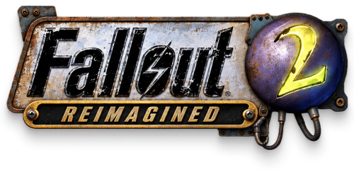
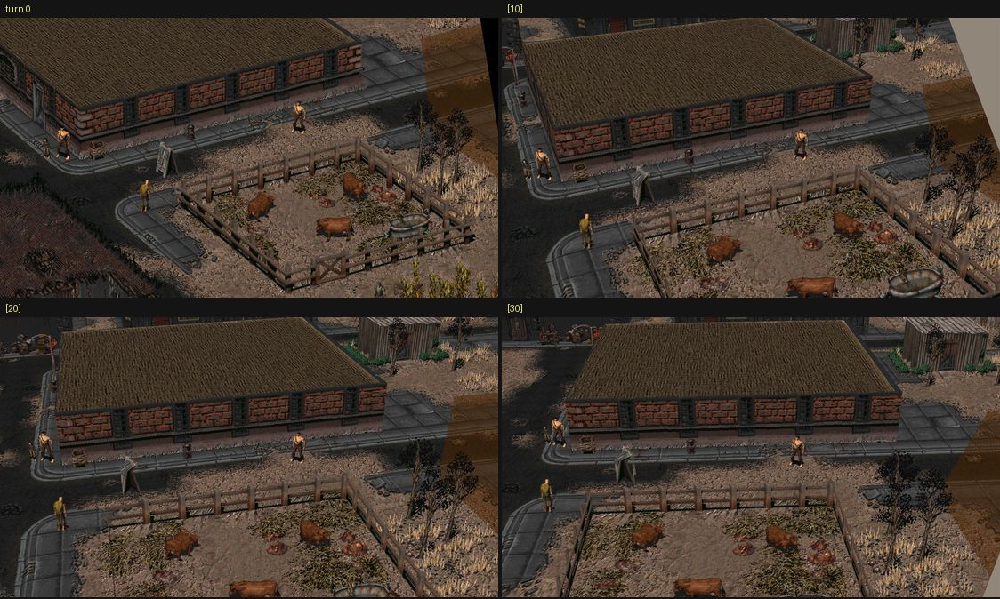
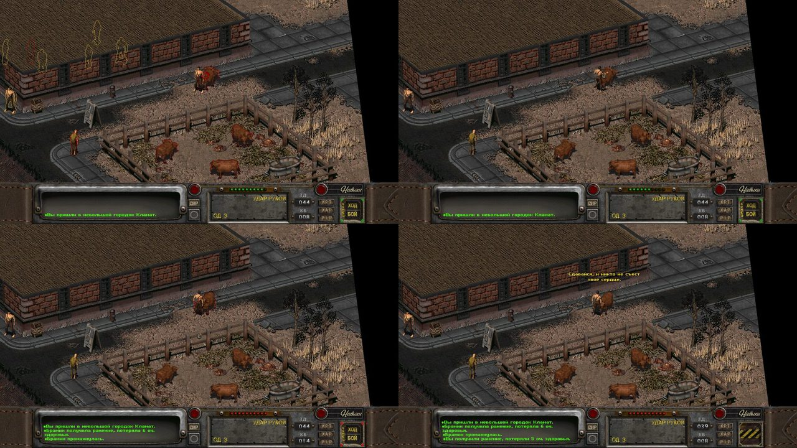

<h1 align="center"></h1>

[English](README.md) | **Русский**

https://github.com/user-attachments/assets/a922572c-d8ae-4121-b489-971a467a1e6a

[Смотреть в 1080p на YouTube](https://www.youtube.com/watch?v=rFMGHM7ZNDc)

Этот проект делается из любви и как дань уважения к Fallout 2, лучшей игре в
мире, на которой я вырос и которую до сих пор прохожу раз в пару лет.

Главная цель: чтобы игра запускалась и плавно работала на современных
компьютерах с мониторами любого разрешения. Заодно немного подтянут визуал,
но без крайностей: 3D-вид есть, но он скорее для удовольствия. Атмосфера
Fallout 2 сохранена полностью, в основе лежит оригинальная игра.

Проект некоммерческий и делается для себя, но присоединиться может каждый.
Если хотите поучаствовать, напишите мне в [Telegram](https://t.me/stepanov_e)
или сразу присылайте PR.

## Установка

[Скачайте лаунчер](https://github.com/Eugenius-S/f2-reimagined/releases/download/latest/Install-F2R.exe)
из постоянно обновляемого [релиза latest](https://github.com/Eugenius-S/f2-reimagined/releases/tag/latest).

1. Установите Fallout 2 из Steam или GOG.
2. Запустите лаунчер. Он сам находит эти установки; если игра не нашлась,
   укажите её папку, где лежат `master.dat` и `critter.dat`.
3. Выберите язык лаунчера: английский или русский. Чтобы играть на русском,
   включите **Установить русский текст**: лаунчер скачает его из официального
   релиза RPU. Чтобы играть в Restoration Project, включите **Restoration
   Project**: лаунчер скачает RPU с его официальной страницы релизов на GitHub
   (около 900 МБ), установит его так же, как ручная установка самого RPU, и
   соберёт его карты в 3D. Ставьте его на чистый Fallout 2, как просит RPU;
   заменённые им файлы сохраняются в `backup/rpu`.
4. Нажмите **Установить / обновить**. При желании включите автоматические
   обновления при запуске. После установки нажмите **Играть**. Кнопка
   **Откатить** восстанавливает предыдущую сборку.

Скачиваемый файл и есть лаунчер. После установки в папке Fallout 2 лежит его
копия `Fallout 2 Reimagined.exe` (со значком радиации): запускайте её, чтобы
играть и обновлять игру. Остальные `.exe` в папке трогать не нужно.

Интернет нужен для новой установки, обновлений и загрузки русского текста и
Restoration Project.

Лаунчер ставит или обновляет `fallout2-ce.exe`, `ce.dat` и
`scene-exporter.exe`, а затем собирает данные сцены из ваших файлов игры.
При установке и обновлении существующий `fallout2.cfg` сохраняется; при
выборе русского меняется только значение `[system].language` на `russian`.
Стандартный конфиг ставится, только если файла нет. Лаунчер не трогает
сохранения, а оригинальный `fallout2.exe` заменяет только для Restoration
Project, у которого он свой (оригинал уходит в `backup/rpu`).

## Что уже сделано

- Здания и часть объектов алгоритмически превращаются в полноценное 3D.
- Небо над 3D-видом вместо чёрной пустоты.
- Тени от солнца и луны: все объёмные объекты отбрасывают тени, которые
  движутся вместе с игровым временем. Персонажи темнеют, заходя в тень зданий.
- Тени от облаков.
- Свечение: лужи токсичной слизи, горящие бочки, лампы, экраны и
  энергетическое оружие.
- Динамический свет: лампы, огонь и вспышки выстрелов освещают стены и пол
  вокруг себя.
- Камеру можно поворачивать клавишами `[` и `]` шагами по 10 градусов
  до 30; зум колёсиком плавный. Персонажи и объекты, у которых в игре есть
  несколько ракурсов, поворачиваются вместе с камерой.


- Чёткий текст: шрифт заменён на более читаемый и мягкий по контрасту,
  диалоги и мелкий текст интерфейса больше не размыты (отключается в меню).
- Игра работает при любом разрешении и на широких мониторах, загрузочные
  экраны и меню растянуты на весь экран.
- Лаунчер ставит игру в один клик поверх Fallout 2 из Steam или GOG и сам
  скачивает обновления.
- Бои идут в 3D от первого хода до конца боя: обводки, курсор шеста с
  шансом попадания, атаки и ходы противника происходят в 3D-виде.



Все новые функции отключаются и настраиваются в меню `3D OPTIONS`.
Диалоги пока показывают оригинальный вид.

## Где работает

В 3D все карты игры: Арройо, Кламат, Дэн, Модок и Город-призрак,
Город Убежища, Гекко, Брокен-Хиллз, Нью-Рино, Реддинг, НКР, Убежища 13 и 15,
армейская база Сьерра, военная база, Сан-Франциско и Наварро, а также все
случайные встречи.

## Клавиши

- `Ctrl+F10`: переключение между оригинальным и новым видом
- `[` и `]`: поворот камеры по 10 градусов за нажатие, до 30
- `Ctrl+F12`: свободный полёт камеры в 3D

Чтобы игра сразу запускалась без 3D, укажите в `fallout2.cfg`:

```ini
[3d]
enabled=0
```

## В планах

- Поддержка Restoration Project
- 3D-модели уникальных объектов: голова Жителя Убежища, вывеска Нью-Рино,
  вход в Город Убежища и другие
- Поддержка macOS
- Поддержка DLSS 5 (очень под вопросом, но хочется попробовать)

## Сборка из исходников

Нужны CMake, Ninja, компонент C++ из Visual Studio, Python 3.12+ и файлы
Fallout 2. Скрипт сборки берёт локальные MSVC и Windows SDK, если они есть;
иначе находит установленную Visual Studio через `vswhere`.

```powershell
powershell -NoProfile -ExecutionPolicy Bypass -File tools/configure-build.ps1 Release
ctest --test-dir build --output-on-failure
py -3 -m pip install -r tools/scene_export/requirements.txt
py -3 -m unittest discover -s tools/scene_export -p 'test*.py' -v
py -3 tools/scene_export/export.py --game-root ./game --maps klamath
```

Файлы игры и собранные данные сцены остаются у вас локально. Подробнее:
[настройка игры](docs/game-setup.md),
[технический план](docs/2026-10-17-fallout2-ce-3d-env-p0-p1.md) и
[3D-дизайн](docs/2026-10-17-fallout2-sprite-lighting-design.md) (на английском).

## Благодарности

- **Interplay и Black Isle**: за Fallout 2.
- **Alexander Batalov** ([fallout2-ce](https://github.com/alexbatalov/fallout2-ce)):
  за Fallout 2 Community Edition, без которого этого проекта не было бы.
- **Сообщество [fallout2-ce](https://github.com/fallout2-ce/fallout2-ce)**:
  за развитие движка, исправления, поддержку sfall и модов.
- **[Apolotary](https://github.com/Apolotary/fallout2-first-person)**:
  за fallout2-first-person. Оттуда взят подход к восстановлению объёма карт и
  часть конвертера.

## Лицензия

Код движка и конвертера распространяется на условиях исходных проектов:
Sustainable Use License 1.0 (см. `ce/LICENSE.md` и лицензии в
`tools/scene_export/`). Это неофициальный некоммерческий фанатский проект.

## Угостить кофе

Если проект нравится и хочется сказать спасибо, можно
[угостить меня кофе](https://app.lava.top/eugenius_s?tabId=donate).
Это по желанию: проект в любом случае остаётся бесплатным.
